# 🎬 AI Video Studio

**Phần mềm edit video chạy ngay trên máy của bạn, có AI hỗ trợ.** Làm Reels, TikTok, YouTube Shorts và video ngang YouTube cho khoá học, bất động sản, review, chia sẻ, tin tức, bán hàng, podcast.

Giao diện tối kiểu editor chuyên nghiệp. Phần mềm có **24 gói style**, **64 template có video xem trước**, **khoảng 200 khối hoạt ảnh HyperFrames**, AI dựng giúp bằng Claude, b-roll và âm thanh tự động, làm hàng loạt từ Excel. Bạn còn có thể **clone style từ bất kỳ video nào** bạn thích.

**Tự lái:** thả video thô vào, khoảng 2 phút sau có video hoàn chỉnh, gồm phụ đề, graphic, b-roll, nhạc, SFX, ảnh bìa và caption đăng. Thả video vào **thư mục tự động** (hoặc AirDrop từ điện thoại) là app tự dựng. Video dài được tự cắt thành nhiều clip ngắn. Gõ chủ đề là ra video mà không cần quay. Có lịch đăng và tự đăng lên YouTube.

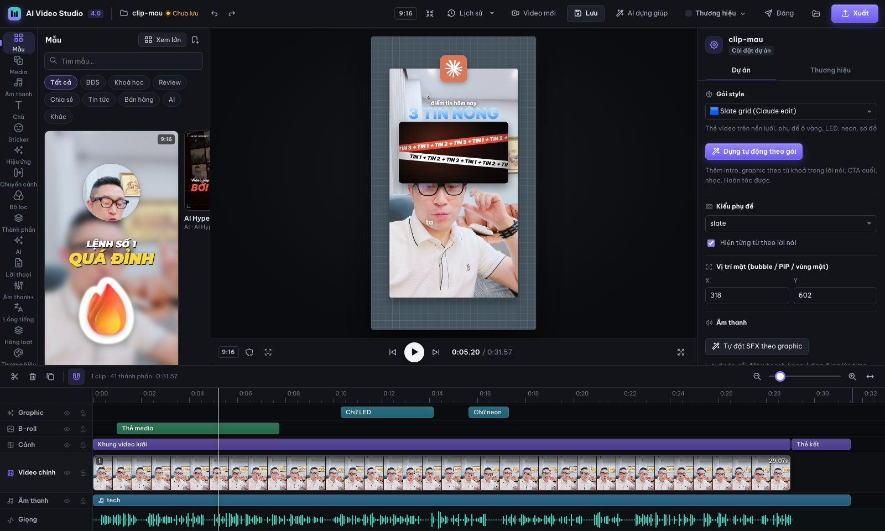

> Video trong ảnh và trong mọi mẫu là **clip quay thật** ở thư mục `sample/`. Cài xong mở lên là thấy ngay các mẫu chạy trên clip này. Sau đó thay bằng video của bạn.

---

## Mục lục
1. [Tính năng](#1-tính-năng)
2. [Yêu cầu](#2-yêu-cầu)
3. [Cài đặt](#3-cài-đặt)
4. [Bắt đầu trong 5 phút](#4-bắt-đầu-trong-5-phút)
5. [Hướng dẫn giao diện](#5-hướng-dẫn-giao-diện)
6. [Các tính năng AI](#6-các-tính-năng-ai-cần-claude-code-cli)
7. [Làm hàng loạt, thương hiệu, đăng mạng xã hội](#7-làm-hàng-loạt-thương-hiệu-đăng-mạng-xã-hội)
8. [Dùng với Claude Code (chat để edit)](#8-dùng-với-claude-code-chat-để-edit)
9. [Dòng lệnh](#9-dòng-lệnh-cho-người-dùng-nâng-cao)
10. [Phím tắt](#10-phím-tắt)
11. [Câu hỏi thường gặp và sửa lỗi](#11-câu-hỏi-thường-gặp-và-sửa-lỗi)
12. [Cấu trúc thư mục](#12-cấu-trúc-thư-mục)
13. [Bản quyền](#13-bản-quyền)

---

## 1. Tính năng

| Nhóm | Có gì |
|---|---|
| **Dựng nhanh** | 64 template chia 9 nhóm: BĐS, Khoá học, Review, Chia sẻ, Tin tức, Bán hàng, Doanh nghiệp, AI, Khác. Có popup thư viện lớn và video xem trước. 24 gói style, 420 graphic (217 graphic gốc + 203 khối HyperFrames: sản phẩm & demo app, số liệu, đánh giá & chốt đơn, logo & tiêu đề động, tên & chức danh, chú thích, chuyển cảnh, nền), 39 kiểu phụ đề |
| **24 gói style** | Slate grid (kiểu "Claude edit"), Bubble hướng dẫn, AI Hype Cam, Luxury, Neon, Keynote, Glow, Podcast, Kinetic, Khoá học, BĐS, Review, Chia sẻ, Chia đôi màn hình, Trước/sau, Phông xanh, Bản tin, Podcast nhiều góc máy, Hỏi đáp, Top N, Điện ảnh, Ảnh theo nhịp nhạc, Quay màn hình… |
| **Edit chuyên sâu** | Track nhiều clip: cắt (⌘B), xoá tự dồn, đảo thứ tự, tốc độ 0,25–4×, lật, nền mờ, 8 bộ lọc màu, chỉnh màu, 15 chuyển cảnh. Keyframe tự do, mặt nạ 8 hình, tách nền và thay phông, sticker người |
| **AI (Claude)** | **AI dựng giúp**: đọc lời nói rồi tự đặt graphic, sửa phụ đề, chọn nhạc và SFX. **Cắt lỗi nói**: bỏ câu lặp, ngắt dài, nói vấp. **Sửa video bằng chữ**: xoá chữ là cắt video |
| **Tự động** | B-roll tự động 4 mức dày, không che mặt. SFX tự đặt 3 mức. Nhạc tự chọn và tự hạ khi đang nói |
| **Âm thanh** | 309 SFX và 30 bản nhạc nền do máy tự tạo, không vướng bản quyền. Lọc ồn giọng 3 mức. Nhiều track âm thanh có fade và EQ. Chuẩn −14 LUFS |
| **Khung hình & ngôn ngữ** | Bám mặt tự động khi đổi khổ. Một lần xuất ra 9:16, 1:1 và 16:9. Dịch, lồng tiếng, phụ đề song ngữ |
| **Tạo style** | **Clone style từ video bất kỳ**, hoặc **tạo style từ mô tả bằng chữ**. Claude viết gói style mới, template và skill riêng |
| **Kinh doanh** | Làm hàng loạt từ Excel/CSV (mỗi dòng một video). Nhiều brand kit. Gói đăng TikTok/YouTube/Facebook/Instagram/Zalo với tiêu đề, caption, hashtag do AI viết |
| **Tự động hoá** | **Tự lái** (một nút từ video thô đến thành phẩm), **thư mục tự động**, hàng đợi chạy nền, **hồ sơ kênh** học từ những gì bạn sửa tay. **AI tự kiểm tra** (chữ tràn, che mặt, sai chính tả, đoạn trống) và tự sửa. **Nhiều phiên bản A/B**. **Video dài thành clip ngắn**. **Chủ đề thành video**. **Lịch đăng** và tự đăng YouTube. Báo về máy Mac khi xong |
| **Nhanh** | Render song song nhiều luồng, nhanh khoảng 5 lần (video 22 giây xuất trong khoảng 8 giây). App Mac: bấm là mở, kéo video vào icon là tạo dự án |

---

## 2. Yêu cầu

| Cần | Ghi chú |
|---|---|
| **macOS** (Apple Silicon hoặc Intel) hoặc **Windows 10/11** | Linux chạy được phần lõi; app Mac chỉ có trên macOS, Windows có lối tắt Desktop |
| **Google Chrome** (hoặc Microsoft Edge trên Windows) | Dùng để render từng khung hình |
| **ffmpeg ≥ 6** | `brew install ffmpeg` |
| **Node.js ≥ 18** | `brew install node` |
| **Python ≥ 3.10** | `brew install python` |
| **Claude Code CLI** *(nên có)* | Bật các tính năng AI (dựng giúp, cắt lỗi nói, tạo style, dịch, gợi ý b-roll, viết caption). Cài theo hướng dẫn tại <https://docs.claude.com/claude-code>, rồi chạy `claude` một lần để đăng nhập |
| Mạng | Cần khi cài, và khi render lần đầu để tải font, emoji, logo |
| Ổ đĩa | Khoảng 1,5 GB (gồm thư viện Python) |

Chưa có Homebrew? Cài tại <https://brew.sh>, rồi chạy:
```bash
brew install ffmpeg node python git
```

---

## 3. Cài đặt

```bash
git clone https://github.com/nguyentatkiem/ai-video-studio.git
cd ai-video-studio
bash install.sh
```

`install.sh` sẽ tự làm các bước sau:
1. Kiểm tra ffmpeg, Node, Python, Chrome, Claude CLI.
2. Cài thư viện Python (faster-whisper, rembg, numpy, scipy…) vào `scripts/.venv`, và cài `puppeteer-core`.
3. Gắn thư mục này thành **skill của Claude Code** tại `~/.claude/skills/ai-video-studio` (dạng symlink, nên `git pull` là cập nhật luôn).
4. Dựng **dự án clip mẫu** từ `sample/` vào `~/.ai-video-studio/footage/clip-mau`.
5. Tạo app **AI Video Studio** trong `~/Applications`.

Tuỳ chọn: `bash install.sh --no-app` (không tạo app), `bash install.sh --no-skill` (không gắn vào Claude Code).

**Cập nhật bản mới:**
```bash
cd ai-video-studio && git pull && bash install.sh
```

### Cài trên Windows 10/11

1. Giải nén file zip (hoặc `git clone`) vào một thư mục, ví dụ `C:\AI\ai-video-studio`.
2. Bấm đúp **`install.cmd`**.
   - Nếu thiếu ffmpeg, Node.js hay Python, trình cài hỏi để tự cài bằng `winget` (có sẵn trên Windows 10/11). Bấm **Y** để đồng ý.
   - Nếu cài xong mà vẫn báo thiếu, đóng cửa sổ rồi bấm đúp `install.cmd` lần nữa, để Windows nhận PATH mới.
3. Cài xong, bấm đúp lối tắt **AI Video Studio** ngoài Desktop (hoặc `studio.cmd`).
   - Trình duyệt mở <http://localhost:5186>.
   - Cửa sổ đen thu nhỏ dưới thanh tác vụ chính là server. Đóng cửa sổ đó là tắt Studio.
4. Tạo dự án: bấm **Video mới** → **Chọn video từ máy…**. Không cần gõ đường dẫn. Nếu dán đường dẫn bằng "Copy as path", app tự bỏ dấu ngoặc kép.

Trên Windows mọi thứ chạy như trên Mac, trừ:
- không có app `.app`;
- thông báo hiện dạng bong bóng ở khay hệ thống;
- chế độ "Chạy cả khi tắt app" của thư mục tự động dùng Task Scheduler thay cho LaunchAgent.

Lỗi hay gặp:
- **"running scripts is disabled"**: hãy chạy `install.cmd`, đừng chạy `install.ps1` trực tiếp.
- **Không render được**: cài Google Chrome, hoặc đặt biến `CHROME_PATH` trỏ tới `chrome.exe` / `msedge.exe`.
- **AI báo không thấy `claude`**: cài Claude Code, mở cửa sổ mới, gõ `claude` một lần để đăng nhập.

---

## 4. Bắt đầu trong 5 phút

### Bước 1: Mở Studio
- Bấm app **AI Video Studio** trong Launchpad hoặc `~/Applications`, **hoặc**
- chạy `bash studio.sh` trong thư mục repo.

Trình duyệt mở **http://localhost:5186** với clip mẫu.

### Bước 2: Chọn mẫu
Bấm **Mẫu** ở thanh trái, rồi bấm **Xem lớn** để mở thư viện. Rê chuột lên mẫu để xem video, bấm vào mẫu để xem chi tiết, sau đó bấm **Dùng mẫu này**. Không ưng thì bấm ⌘Z.

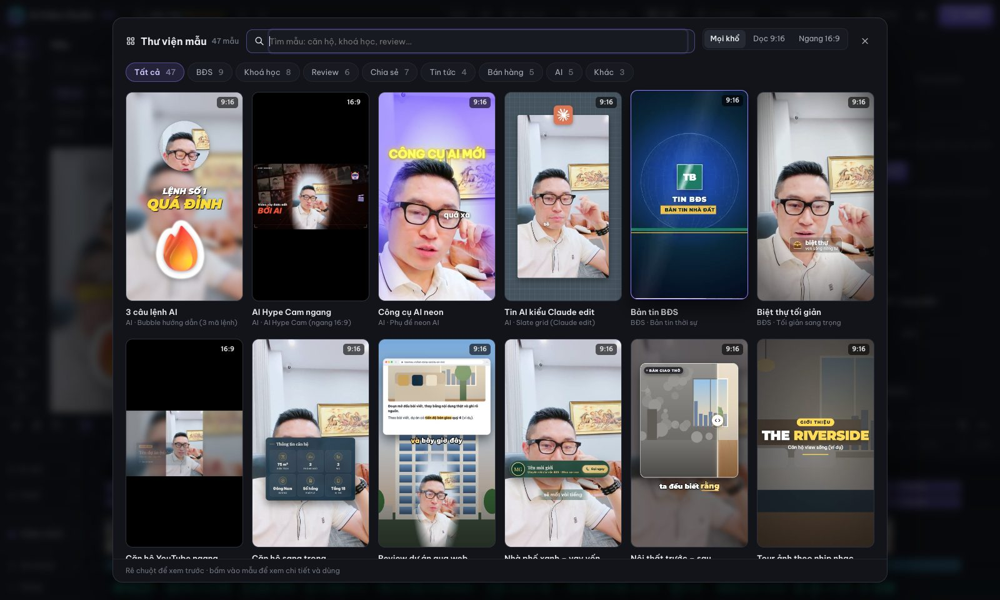
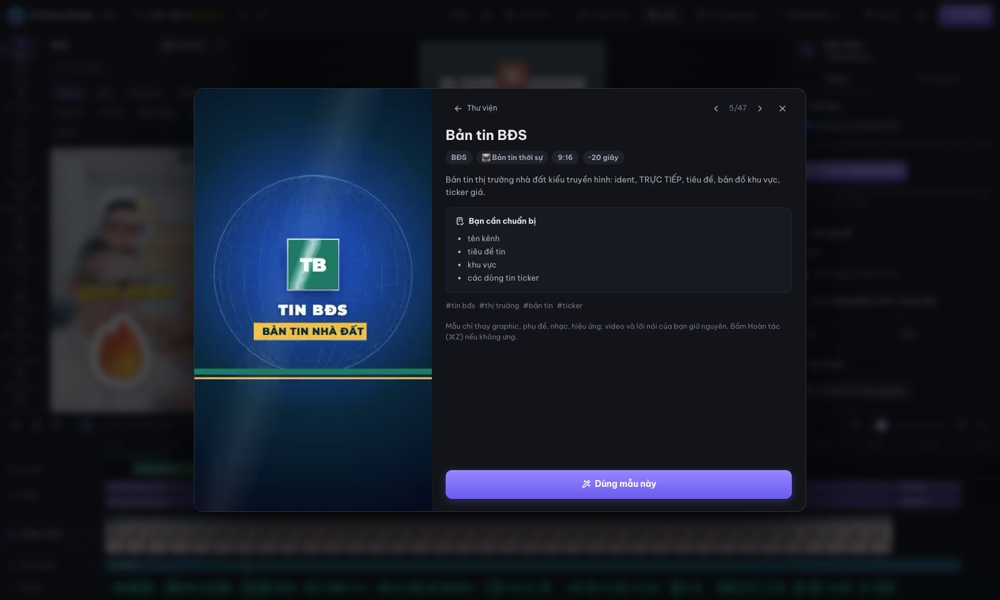

### Bước 3: Dùng video của bạn
Bấm **Video mới** trên thanh trên (hoặc kéo video thả vào icon app). Chọn gói style, tiêu đề, khổ dọc hoặc ngang. App tự làm phần còn lại:
- nhận giọng nói,
- cắt khoảng lặng,
- tạo phụ đề,
- dựng bản đầu theo gói.

Có thể làm cùng việc đó bằng lệnh:
```bash
bash studio.sh --new ~/Downloads/video-cua-ban.mp4
```

### Bước 4: Tinh chỉnh
- Bấm **AI dựng giúp** để Claude tự dựng, **hoặc** chọn mẫu.
- Mở mục **Tự động** ở thanh trái, bấm **Tự thêm B-roll + âm thanh**.
- Bấm vào bất kỳ chữ hay graphic nào trên khung hình để sửa: kéo để di chuyển, chỉnh ở bảng bên phải.

### Bước 5: Xuất
Bấm **Xuất** và chọn chất lượng (720p, 1080p hoặc 4K). Muốn có nhiều khổ thì tick thêm 1:1 hoặc 16:9. File nằm trong thư mục `out/` của dự án. Sau đó bấm **Đăng** để AI viết caption cho từng nền tảng.

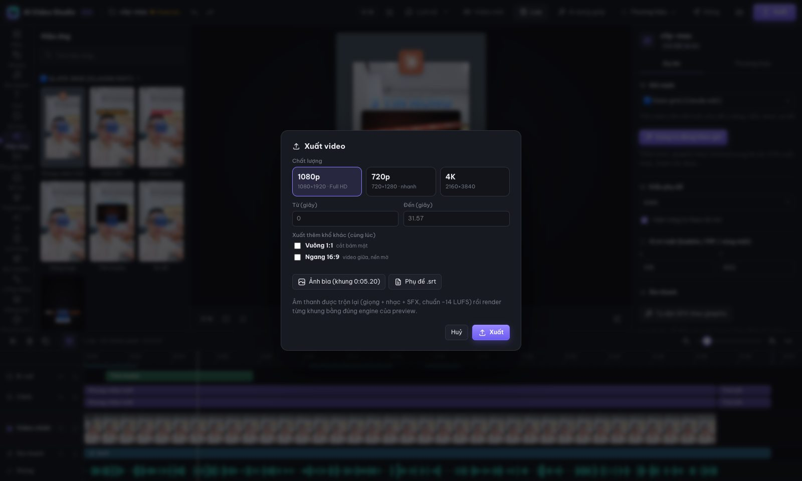

---

## 5. Hướng dẫn giao diện

```
┌ Thanh trên: Hoàn tác · Lịch sử · Video mới · Lưu · AI dựng giúp · Thương hiệu · Đăng · Xuất ┐
│ Thanh │ Thư viện của  │        Khung xem trước          │ Bảng thuộc tính (Inspector) │
│ trái  │ mục đang chọn │   (bấm và kéo trực tiếp)        │ của thứ đang chọn           │
├───────┴───────────────┴─────────────────────────────────┴─────────────────────────────┤
│ Timeline: Phụ đề · Chữ · Graphic · B-roll · Cảnh · Video chính · Âm thanh · Giọng        │
└───────────────────────────────────────────────────────────────────────────────────────┘
```

### Các mục ở thanh trái (22 mục)

| Mục | Dùng để |
|---|---|
| **Mẫu** | 64 template (có nhóm **Doanh nghiệp**: giới thiệu công ty, ra mắt sản phẩm, demo app, báo cáo số liệu, tuyển dụng, sự kiện…); **Xem lớn** để mở popup; **Lưu thành mẫu** để lưu video đang làm làm mẫu riêng |
| **Media** | Ảnh và video của bạn (kéo thả để tải lên), b-roll có sẵn |
| **Âm thanh** | 30 bản nhạc nền và 309 SFX, bấm để nghe thử, kéo vào timeline |
| **Chữ** | 14 kiểu chữ có sẵn (vàng, neon, lửa, sang trọng, đánh máy…) và 9 kiểu hoạt ảnh |
| **Sticker** | Emoji 3D |
| **Hiệu ứng** | 217 graphic của 24 gói và 203 khối HyperFrames chia 8 nhóm (cộng graphic của style bạn tạo), có ảnh xem trước trên clip thật. Chọn một khối HyperFrames rồi mở tab **Khối** để sửa chữ, màu, số, tốc độ |
| **Chuyển cảnh** | 15 kiểu, kéo thả vào chỗ nối giữa 2 clip |
| **Bộ lọc** | 8 bộ màu, xem trước ngay trên khung hình |
| **Thành phần** | Danh sách mọi thứ đang có trong video, bật hoặc tắt từng cái |
| **Tự lái** | Thả video vào là tự dựng đến thành phẩm; hàng đợi, thư mục tự động, hồ sơ kênh |
| **Video dài** | Video dài thành nhiều clip ngắn; gõ chủ đề ra video không cần quay |
| **Lịch đăng** | Lịch tuần kéo thả, tự xếp lịch, tự đăng YouTube, nhắc giờ đăng các nền tảng khác |
| **Agent** | Cổng Telegram (gửi video qua chat → nhận lại video đã dựng), chấm điểm video, tự cải tiến hồ sơ kênh, đề xuất việc nên làm |
| **AI** | Dựng giúp, Cắt lỗi nói |
| **Lời thoại** | Sửa video bằng chữ: bôi đen chữ rồi bấm Xoá là video bị cắt theo |
| **Âm thanh+** | Lọc ồn giọng, hạ nhạc khi nói, thêm track âm thanh (lời dẫn, nhạc phụ, tiếng nền) |
| **Lồng tiếng** | Dịch phụ đề, phụ đề song ngữ, lồng tiếng bằng giọng máy |
| **Hàng loạt** | Nhiều video từ một file Excel/CSV |
| **Thương hiệu** | Lưu nhiều brand kit (màu, font, logo, SĐT…) |
| **B-roll AI** | Tìm ảnh stock, Claude gợi ý b-roll, tạo ảnh AI (cần key) |
| **Tạo style** | Clone style từ video, hoặc tạo style từ mô tả |
| **Tự động** | Tự thêm B-roll và âm thanh chỉ bằng một nút |

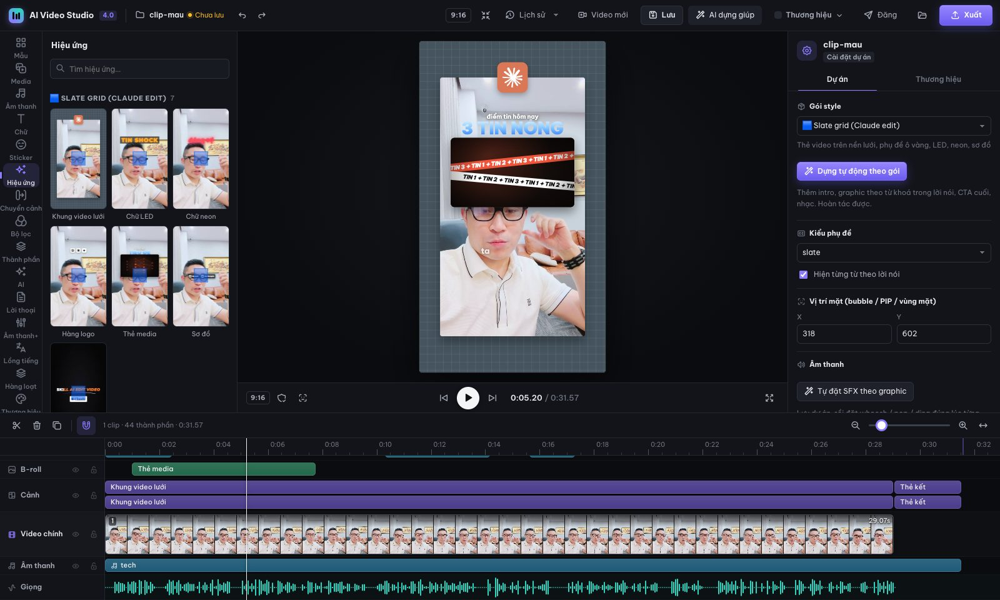

### Timeline
- **Kéo khối** để dời thời gian; **kéo mép** để đổi độ dài; nam châm 🧲 giúp khối tự bám vào playhead và mép khối khác.
- **Video chính**: ⌘B để cắt tại playhead; Delete để xoá (phần phía sau tự dồn lên, phụ đề và graphic dời theo); kéo để đổi thứ tự clip.
- Mỗi track có 👁 (ẩn/hiện) và 🔒 (khoá).
- ⌘ + cuộn chuột để phóng to hoặc thu nhỏ timeline.

### Bảng thuộc tính (bên phải)
- **Không chọn gì:** cài đặt dự án (gói style, kiểu phụ đề, vị trí mặt, thương hiệu).
- **Chọn clip:** các tab Cơ bản / Tốc độ / Âm thanh / Màu / Chuyển cảnh / Mặt nạ / Bám mặt.
- **Chọn chữ:** Cơ bản / Hoạt ảnh / Vị trí / Keyframe.
- **Chọn graphic:** Cơ bản / Vị trí / Keyframe / Nâng cao (sửa JSON).
- Ô **Ghi chú cho Claude**: viết yêu cầu sửa, rồi nói với Claude Code "xem ghi chú trong editor".

---

## 6. Các tính năng AI (cần Claude Code CLI)

Các tính năng này gọi lệnh `claude -p` ngay trên máy, dùng **tài khoản Claude của chính bạn**. Không cần API key riêng.

### AI dựng giúp
Bấm nút **AI dựng giúp** trên thanh trên, chọn mục tiêu video, giọng điệu, mật độ graphic và gõ yêu cầu thêm. Mất khoảng 30–60 giây. Claude sẽ:
- chọn gói style,
- sửa lỗi nhận giọng trong phụ đề (giữ nguyên thời gian từng chữ),
- đặt 6–15 graphic đúng lúc nói từ khoá,
- chọn nhạc và SFX.

Không ưng thì Hoàn tác.

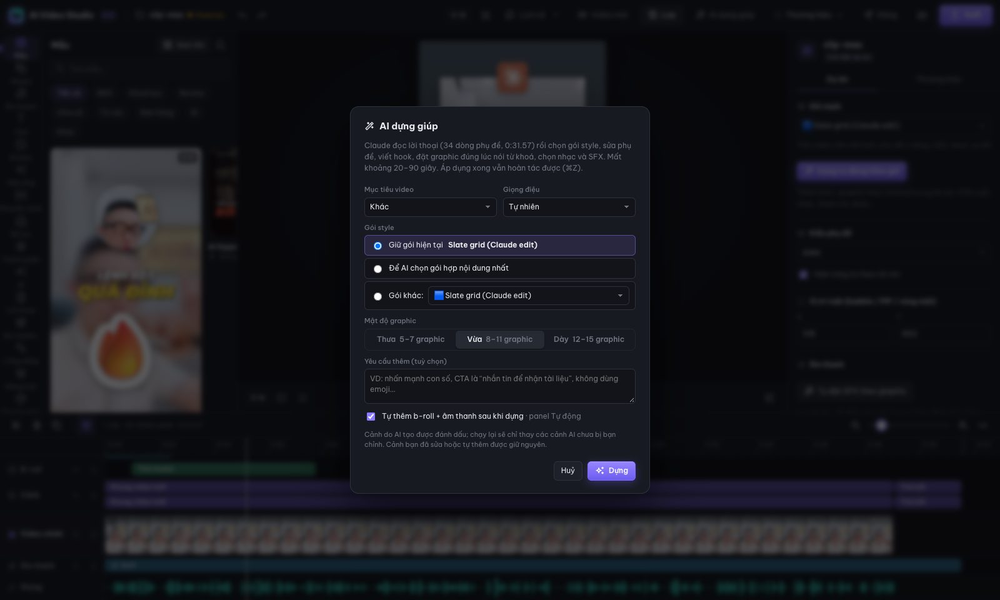

### Cắt lỗi nói và sửa video bằng chữ
- **AI → Cắt lỗi nói**: tìm câu lặp, chỗ ngắt dài và (nếu tick Claude) câu nói vấp. Tick những chỗ muốn bỏ rồi bấm **Cắt tất cả đã chọn**.
- **Lời thoại**: toàn bộ lời nói hiện thành chữ. Bôi đen đoạn thừa và bấm **Xoá đoạn**, video tự cắt và tiếng hình vẫn khớp.

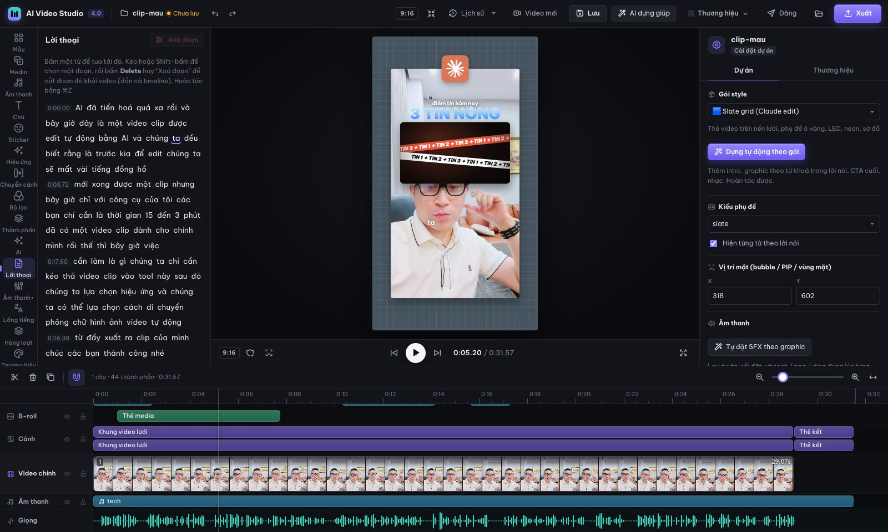

### Tự động: B-roll và âm thanh
- **B-roll:** chọn mật độ (thưa, vừa, dày, rất dày) và nguồn (b-roll động có sẵn, chữ nổi, emoji, ảnh của bạn, ảnh stock, Claude chọn).
- **Âm thanh:** chọn mức SFX (nhẹ, vừa, phong phú) và bật nhạc tự động.
- Bấm **Tự thêm B-roll + âm thanh**. Chạy lại sẽ chỉ thay phần tự động, phần bạn đã sửa tay được giữ nguyên.

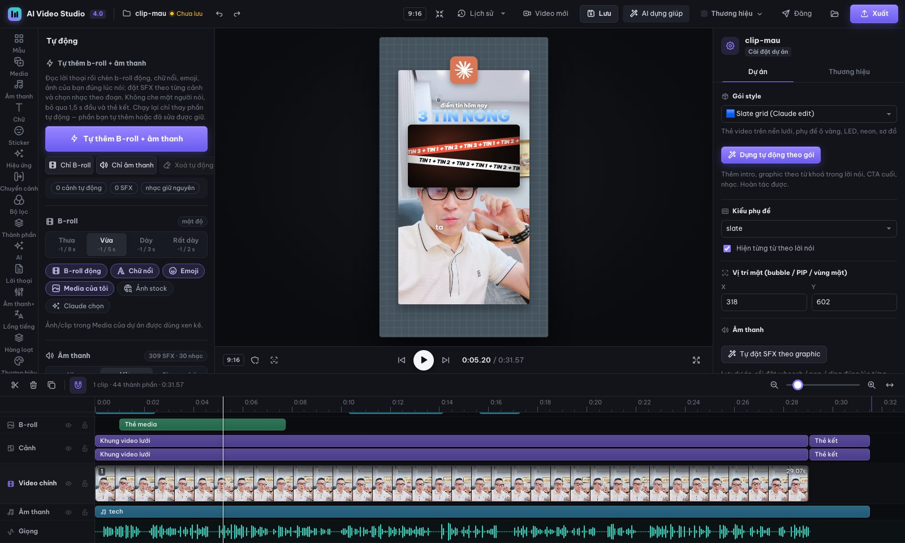

### Tạo style: clone từ video hoặc từ mô tả
- **Clone từ video:**
  1. Đưa vào video đã edit mà bạn thích (TikTok, Reels, YouTube).
  2. Máy phân tích nhịp cắt, màu, vị trí chữ, nhạc và SFX.
  3. Claude xem ảnh khung hình rồi viết **gói style mới**, **template** có video xem trước, và **skill riêng** cho Claude Code (`~/.claude/skills/video-style-<tên>`).
- **Từ mô tả:** gõ ví dụ *"Video BĐS sang trọng tông đen – vàng gold, chữ serif, intro tên dự án, thẻ giá, bản đồ vị trí, CTA gọi điện"*.
- Code Claude viết được **dựng thử tự động trong engine**. Có lỗi thì Claude tự sửa (tối đa 2 lần) rồi mới cài.
- Mỗi lượt mất khoảng 7–10 phút với model mặc định. Muốn nhanh và rẻ hơn thì chọn Sonnet.
- Repo đã có sẵn 2 style tạo theo cách này: **Studio lưới AI** (clone từ video) và **BĐS Đen Gold** (từ mô tả).

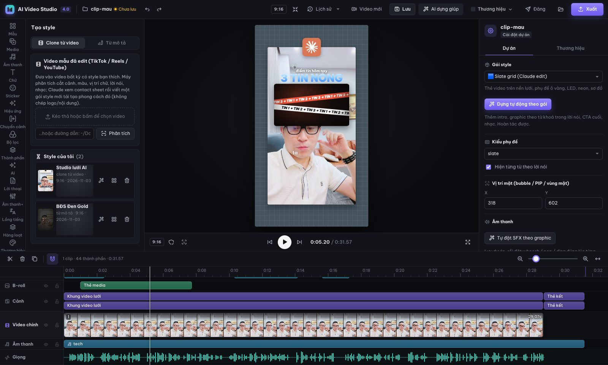

### B-roll AI, dịch và lồng tiếng
- **B-roll AI:**
  - Tìm ảnh trên Wikimedia Commons không cần key.
  - Muốn dùng Pexels/Pixabay hoặc tạo ảnh AI (OpenAI/Gemini) thì bấm ⚙ để dán key. Key lưu ở `~/.ai-video-studio/config.json` và không bao giờ đưa lên git.
  - Claude gợi ý b-roll cho từng câu.
- **Lồng tiếng:**
  - Dịch sang tiếng Anh, Trung, Nhật, Hàn, Thái… và hiện phụ đề song ngữ.
  - Lồng bằng giọng máy của macOS (offline) hoặc edge-tts (cần mạng).

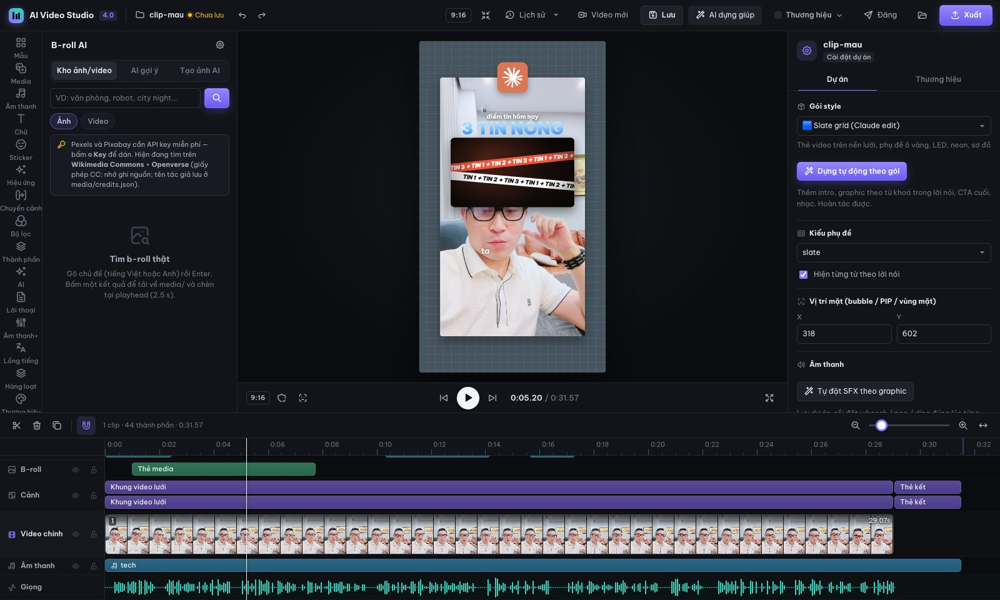

### Tự lái: thả video vào, nhận video hoàn chỉnh
- Bấm **Tự lái** (biểu tượng tên lửa) rồi thả video thô vào ô lớn, hoặc **Chọn file**. Studio tự làm hết: phụ đề, cắt lỗi nói, AI dựng giúp, b-roll, SFX + nhạc, AI kiểm tra lỗi, xuất MP4 (thêm 1:1 / 16:9 nếu muốn), ảnh bìa, phụ đề .srt và nội dung đăng cho từng nền tảng. Khoảng 1,5–2 phút cho clip 30–45 giây.
- Chạy **nền, theo hàng đợi**: vẫn chỉnh video khác được trong lúc chờ. Xem từng bước đang chạy, huỷ, thử lại (chạy tiếp từ bước dừng), đổi thứ tự, mở dự án ra chỉnh tay.
- **Hồ sơ kênh**: mỗi kênh một bộ cài đặt (thương hiệu, gói hoặc “AI chọn”, mật độ b-roll, mức âm thanh, nhạc, làm sạch giọng, cắt lỗi nói, khổ xuất, CTA, nền tảng đăng, giờ đăng). **Học từ chỉnh sửa**: khi bạn sửa lại video Tự lái làm (xoá emoji, đổi kiểu phụ đề, tắt nhạc…), hồ sơ ghi nhận và sau ít nhất 2 video sẽ tự điều chỉnh; xem và xoá được điều đã học.
- **Thư mục tự động**: bật lên rồi thả video vào `~/Movies/AI Video Studio/Thả video vào đây` (Finder, AirDrop…), kết quả ra `…/Đã xong/<tên>/`. Có thể **chạy cả khi tắt app** và bật **Thả vào app = tự lái** (thả video vào biểu tượng app).
- Dòng lệnh: `node scripts/autopilot.mjs clip.mov --out ~/Desktop/xong`. Chi tiết: [references/autopilot.md](references/autopilot.md).

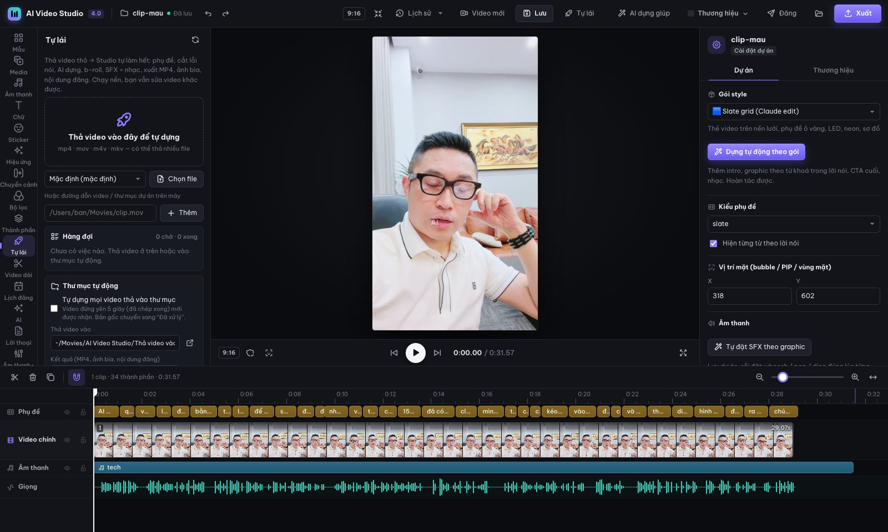

### Video dài → clip ngắn · Chủ đề → video (không cần quay)
- Bấm **Video dài** (biểu tượng cây kéo). Tab **Video dài**: thả video dài (livestream, podcast 30–90 phút), chọn số clip, độ dài, khung. Máy nghe cả video một lần, Claude chọn các đoạn tự đứng được (hook mạnh 3 giây đầu, trọn ý, không nhắc “như tôi vừa nói”), mỗi đoạn thành một dự án có phụ đề; video ngang vào khung dọc thì tự bám mặt. Danh sách có tiêu đề, hook, mốc thời gian, điểm, ảnh xem trước + nút **Mở**, **Tự lái tất cả** (đưa vào hàng đợi Tự lái), **Xuất tất cả**.
- Tab **Chủ đề**: gõ chủ đề (vd “3 mẹo dùng ChatGPT cho người bán hàng online”). Claude viết kịch bản, giọng Linh đọc (offline), phụ đề khớp từng chữ, hình là b-roll động + chữ kinetic + nhạc/SFX. Khoảng 1 phút cho video 45 giây.
- Dòng lệnh: `node scripts/highlights.mjs video.mp4 --out dir --n 6`, `node scripts/topic_video.mjs "chủ đề" --out dir --export`. Chi tiết: [references/longform-topic.md](references/longform-topic.md).

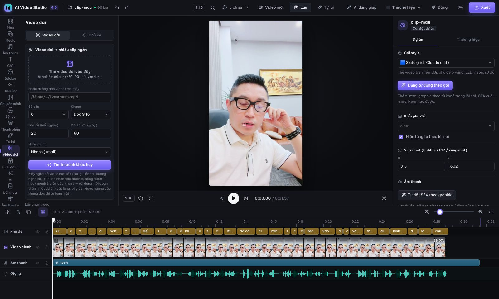

### AI tự kiểm tra · Nhiều phiên bản (A/B)
- Panel **AI** → thẻ **Kiểm tra chất lượng**: máy render các khung bằng đúng engine rồi dò chữ tràn khung, graphic che mặt lúc đang nói, phụ đề bị đè, đoạn > 6 giây không có gì, phụ đề quá dài, file thiếu, hook 2 giây đầu, độ to âm thanh và nhạc át giọng; sau đó Claude xem ảnh để soi hook, **chính tả có dấu**, nhịp, độ đồng bộ. Ra điểm 0–100 và danh sách lỗi (bấm để tua tới). **Kiểm tra & tự sửa** tự dời/thu nhỏ graphic, sửa chữ sai, thêm hook, lấp đoạn trống, tách phụ đề dài, hạ nhạc… rồi kiểm tra lại; có ảnh trước/sau và nút **Hoàn tác sửa**.
- Hộp **Xuất** có ô **AI kiểm tra & sửa trước khi xuất**; hộp “Xuất xong” hiện điểm trước → sau.
- Thẻ **Nhiều phiên bản (A/B)** → **Tạo 3 phiên bản**: 3 dự án anh em với hook mở đầu khác nhau do Claude viết (có bản mở bằng câu nói mạnh nhất kéo lên đầu) và/hoặc gói style khác; tick để xuất luôn 720p; bảng **So sánh** phát cạnh nhau, nút **Mở** từng bản.
- Dòng lệnh: `node scripts/ai_qc.mjs du-an [--fix] [--no-claude]`, `node scripts/variants.mjs du-an --n 3 --kind hook|style|both [--export]`. Chi tiết: [references/qc-variants.md](references/qc-variants.md).

---

## 7. Làm hàng loạt, thương hiệu, đăng mạng xã hội

### Hàng loạt từ Excel hoặc CSV
1. Mở **Hàng loạt** ở thanh trái và chọn nguồn: một template, hoặc dự án đang mở.
2. Tải lên file `.xlsx` hoặc `.csv`; mỗi dòng sẽ thành một video. Có sẵn file ví dụ `examples/batch/bds-can-ho-vi-du.csv` gồm 5 căn hộ (dữ liệu ví dụ).
3. Ghép cột vào chỗ trống: ví dụ cột `gia` vào `{{gia}}`, cột `anh_1` vào ảnh mẫu. Xem thử dòng 1.
4. Chọn giọng: tự động, đọc bằng giọng máy cột `script`, không giọng, hoặc ảnh theo nhịp nhạc. Rồi bấm **Bắt đầu**.

Mỗi dòng ra một thư mục dự án (mở lại sửa được) và một MP4. Có thể dừng giữa chừng và chạy tiếp.

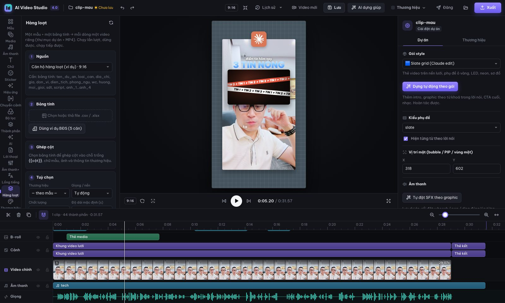

### Thương hiệu
Lưu nhiều brand kit: màu chính, màu nhấn, font, logo, tên, handle, SĐT, website, gói mặc định. Đổi nhanh bằng menu **Thương hiệu** trên thanh trên. Mọi gói style đều tự dùng màu và logo của brand kit.

### Đăng
Bấm **Đăng** sau khi xuất. Claude viết tiêu đề, caption, hashtag và bình luận đầu tiên cho TikTok, YouTube Shorts, Facebook Reels, Instagram Reels và Zalo. App cũng:
- kiểm tra thông số (thời lượng, khổ, dung lượng),
- xuất ảnh bìa,
- mở trang upload và mở thư mục chứa file.

*App không tự đăng thay bạn: muốn vậy phải xin quyền API của từng nền tảng.*

### Lịch đăng và tự tải lên YouTube
Mục **Lịch đăng** (icon lịch ở thanh trái) hoặc nút **Lên lịch…** trong hộp thoại **Đăng**:
- **Lịch tuần** kéo-thả để đổi ngày/giờ, bấm ô trống để thêm, bấm mục để sửa/xoá/thử lại.
- **Xếp lịch tự động**: chọn các video đã xuất + nền tảng → app rải vào các khung giờ đăng (mặc định 11:30 và 19:30, sửa trong Cài đặt lịch), dùng caption AI của từng dự án.
- **YouTube**: bấm **Kết nối YouTube**, làm theo 6 bước (tạo OAuth client “Desktop app” của chính bạn, miễn phí). Từ đó app tự tải video lên trước giờ đăng và hẹn YouTube công khai đúng giờ (có tải tiếp khi mất mạng). Lưu ý: dự án Google Cloud chưa được YouTube kiểm duyệt thì video tải qua API bị khoá ở chế độ Riêng tư.
- **TikTok, Facebook, Instagram, Zalo**: 10 phút trước có thông báo; đúng giờ app mở trang đăng, mở thư mục chứa file và chép sẵn caption — bạn chỉ cần kéo file vào và dán.

App kiểm tra lịch mỗi phút khi đang mở. Dòng lệnh: `node scripts/publish.mjs run-due` (chi tiết: `references/publish-schedule.md`).

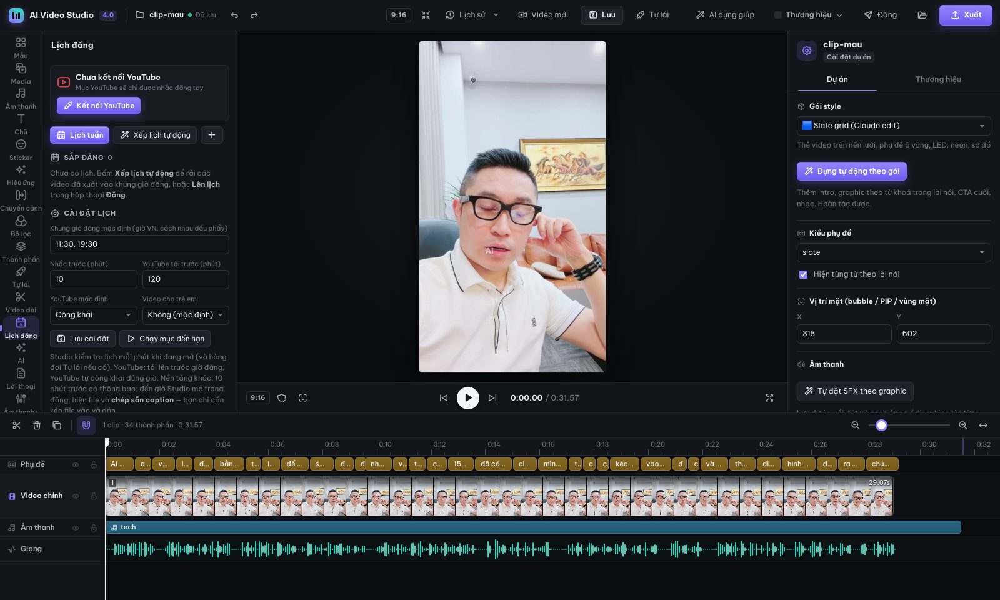

---

### Agent qua Telegram, tự cải tiến và tự đề xuất

**Kết nối Telegram (5 phút):**
1. Trong Telegram, nhắn **@BotFather** → `/newbot` → đặt tên. BotFather trả về một **token**.
2. Trong Studio mở mục **Agent** → dán token → **Kết nối**.
3. Bấm **Lấy mã ghép nối**, gửi `/start <mã>` cho bot của bạn. Chỉ chat đã ghép nối mới điều khiển được bot.

**Dùng trong Telegram:**
- **Gửi video** (tối đa 20 MB, giới hạn của Telegram): Tự lái dựng xong sẽ gửi lại video, kèm điểm AI kiểm tra và caption.
  - Video lớn hơn: chép vào thư mục tự động, hoặc nhắn đường dẫn file trên máy.
- `/chude <chủ đề>`: làm video không cần quay.
- `/trangthai`: xem hàng đợi.
- `/dexuat`: xem đề xuất.
- `/caitien`: tự cải tiến.
- `/hoso`: chọn hồ sơ kênh.
- Nhắn tự nhiên, ví dụ "làm video về cách chọn kem chống nắng": agent (Claude) hiểu ý và tự chạy đúng việc.

**Vòng phản hồi:**
1. Sau mỗi video, bot hỏi chấm **1–5★**, có nút chọn điều cần sửa và ô gõ góp ý:
   - Mở đầu yếu, Phụ đề khó đọc
   - Nhạc to/nhỏ, Tiếng động nhiều
   - Hiệu ứng rối/ít, Che mặt
   - Dài quá
   - Video xuất trong Studio thì chấm ở **Agent → Phản hồi**.
2. Cứ 3 phản hồi, app **tự cải tiến** hồ sơ kênh:
   - chỉnh mật độ hiệu ứng, âm lượng nhạc, mức tiếng động, kiểu phụ đề;
   - đưa góp ý vào hướng dẫn cho AI dựng giúp;
   - Claude phân tích thêm điểm và lỗi AI kiểm tra.
   - Mọi thay đổi ghi ở **Agent → Cải tiến & đề xuất**. Tắt được bằng ô "Tự cải tiến sau mỗi 3 phản hồi".
3. **Tự đề xuất:** mỗi sáng (giờ chỉnh được) bot gửi bản tin kèm đề xuất, mỗi đề xuất có nút **Áp dụng / Bỏ qua**:
   - chạy lại việc lỗi;
   - lên lịch đăng 3 ngày tới;
   - chỉnh hồ sơ;
   - ý tưởng video tiếp theo lấy từ lời thoại gần đây.

Bot chạy khi Studio đang mở. Muốn chạy riêng (không mở Studio), dùng lệnh `node scripts/telegram.mjs run`; lệnh này chạy luôn hàng đợi. Token lưu trong `~/.ai-video-studio/telegram.json`, chỉ tài khoản của bạn đọc được.

## 8. Dùng với Claude Code (chat để edit)

Sau khi cài, mở Claude Code và nói chuyện bình thường, ví dụ:

> *"Edit video ~/Downloads/can-ho.mp4 theo kiểu bất động sản sang trọng, thêm thẻ giá 3,2 tỷ, SĐT 0900 000 000"*
>
> *"Dựng video này kiểu tin tức AI nền lưới"*
>
> *"Xem ghi chú trong editor"* (Claude đọc ghi chú bạn để trong Studio và sửa theo)
>
> *"Clone style của video ~/Downloads/mau.mp4"*
>
> *"Làm 20 video từ file ~/Desktop/can-ho.xlsx"*

Claude dùng skill `ai-video-studio` để chọn gói, dựng, render và kiểm tra khung hình, rồi mở Studio để bạn chỉnh tiếp. Các style bạn tạo cũng thành skill riêng, Claude tự nhận ra khi bạn nhắc tên style.

---

## 9. Dòng lệnh (cho người dùng nâng cao)

```bash
S=~/.claude/skills/ai-video-studio; PY=$S/scripts/.venv/bin/python

# Mở Studio / tạo dự án
bash $S/studio.sh [thư-mục-dự-án] [--port 5190]
bash $S/studio.sh --new video.mp4 [thư-mục-dự-án]

# Render
node $S/scripts/render.mjs du-an/timeline.json out.mp4 [--workers 6] [--fast] [--from 0 --to 10]
node $S/scripts/render.mjs du-an/timeline.json x --still 5.2 khung.jpg
$PY $S/scripts/mix_audio.py du-an/timeline.json                 # trộn giọng + nhạc + SFX (−14 LUFS)

# AI và tự động
node $S/scripts/ai_edit.mjs du-an --apply                        # AI dựng giúp
$PY  $S/scripts/fillers.py du-an/work/captions.json out.json      # dò lỗi nói
node $S/scripts/auto_broll.mjs du-an/timeline.json --density day [--claude]
$PY  $S/scripts/auto_sfx.py du-an/timeline.json --level phongphu --music auto

# Tạo style
node $S/scripts/style_lab.mjs clone ~/Downloads/video-mau.mp4 --name "Style của tôi" [--model sonnet]
node $S/scripts/style_lab.mjs describe "Video review mỹ phẩm tông hồng pastel, chữ tròn" --orient vertical
node $S/scripts/style_lab.mjs list | delete <id>

# Khác
node $S/scripts/batch.mjs --help                                   # làm hàng loạt
$PY  $S/scripts/dub.py --help                                      # dịch + lồng tiếng
$PY  $S/scripts/face_track.py --help                               # bám mặt
node $S/scripts/build_templates.mjs ~/.ai-video-studio/footage/clip-mau   # render lại preview mẫu
node $S/scripts/selftest.mjs $S/engine/index.html ~/.ai-video-studio/footage/clip-mau/timeline.json
bash $S/scripts/make_app.sh                                        # tạo lại app Mac
```

Tài liệu kỹ thuật chi tiết nằm trong `references/`. Nên bắt đầu từ `SKILL.md`, `references/studio.md`, `references/packs.md` (cách viết gói style mới) và `references/templates.md`.

---

## 10. Phím tắt

| Phím | Việc |
|---|---|
| Space | Phát / dừng |
| ← / → | Lùi / tiến 1 khung (⇧: 1 giây) |
| ⌥ + mũi tên | Dịch chữ/graphic đang chọn 1 px (⇧: 10 px) |
| ⌘B | Cắt clip tại playhead |
| Delete / ⌫ | Xoá (clip thì tự dồn) |
| ⌘D | Nhân bản |
| ⌘Z / ⇧⌘Z | Hoàn tác / làm lại |
| ⌘S | Lưu |
| + / − | Phóng to / thu nhỏ timeline |
| ⇧Z | Vừa khung |
| Esc | Bỏ chọn / đóng popup |
| ← → Enter (trong popup mẫu) | Chuyển mẫu / dùng mẫu |

---

## 11. Câu hỏi thường gặp và sửa lỗi

**Mở http://localhost:5186 không lên?**
Server chưa chạy. Bấm app, hoặc chạy `bash studio.sh`. Nhật ký của app nằm ở `~/Library/Logs/AIVideoStudio.log`.

**macOS báo "không mở được app vì không xác định nhà phát triển"?**
App được tạo ngay trên máy bạn và chưa được Apple xác thực. Chuột phải vào app, chọn **Open**, rồi chọn **Open** lần nữa. Chỉ cần làm một lần.

**Nút AI báo thiếu Claude?**
Cài Claude Code CLI và chạy `claude` một lần để đăng nhập. Kiểm tra bằng `claude -p "xin chào"`.

**Phụ đề nhận giọng sai chữ?**
Lúc tạo dự án, chọn độ chính xác cao hơn (model whisper lớn hơn). Hoặc bấm **AI dựng giúp** để Claude sửa lỗi chính tả mà vẫn giữ thời gian từng chữ. Cũng có thể sửa tay trong tab phụ đề.

**Render chậm hoặc máy nóng?**
Giảm số luồng: `--workers 2`. Mỗi luồng tốn khoảng 300 MB RAM.

**Muốn dời thư mục dữ liệu?**
Đặt biến môi trường `AVS_HOME` (mặc định `~/.ai-video-studio`) trước khi chạy `install.sh` / `studio.sh`. `AVS_SKILLS_DIR` (mặc định `~/.claude/skills`) là nơi lưu skill `video-style-*` của style bạn tạo; `AVS_SKILL_DIR` là chỗ `install.sh` gắn skill chính.

**Gỡ cài đặt:**
```bash
rm -rf ~/.claude/skills/ai-video-studio ~/.ai-video-studio ~/"Applications/AI Video Studio.app" \
       ~/"Library/Application Support/AIVideoStudio" ~/Library/Logs/AIVideoStudio.log
```
Sau đó xoá thư mục repo. Style bạn đã tạo còn là skill riêng `~/.claude/skills/video-style-*`, xoá nếu không dùng nữa.

---

## 12. Cấu trúc thư mục

```
ai-video-studio/
├─ install.sh              cài đặt một lệnh
├─ studio.sh               mở Studio
├─ SKILL.md                hướng dẫn cho Claude Code (skill)
├─ sample/                 video gốc + dự án clip mẫu (phụ đề đã sửa)
├─ engine/                 engine dựng hình HTML → MP4 (engine.js, 24 gói trong packs/, style người dùng trong packs/user/, khối HyperFrames trong hf/)
├─ studio/                 giao diện editor + server (features/*.js, routes/*.mjs là các tính năng cắm thêm)
├─ scripts/                render, trộn âm thanh, nhận giọng, AI, b-roll, hàng loạt, tạo style, app Mac…
├─ templates/              64 template + previews/ (video xem trước) + user/ (mẫu bạn lưu)
├─ assets/                 309 SFX, 30 nhạc, danh mục 4.232 b-roll động, model nhận diện mặt
├─ examples/               timeline ví dụ cho từng gói, ảnh mẫu, file hàng loạt ví dụ
├─ references/             tài liệu kỹ thuật từng phần
└─ docs/images/            ảnh chụp màn hình
```

Dữ liệu của bạn nằm ngoài repo, ở `~/.ai-video-studio/`: clip mẫu, brand kit, style đã tạo, key API, nên `git pull` không làm mất gì.

---

## 13. Bản quyền

- **Mã nguồn:** giấy phép MIT, xem [LICENSE](LICENSE).
- **Video mẫu** (`sample/`, cùng các ảnh xem trước trong `templates/previews/`, `studio/thumbs/`, `docs/images/` được làm từ video này): thuộc chủ sở hữu repo. Chỉ được dùng để xem thử và học cách dùng phần mềm. **Không** dùng lại, cắt ghép hay đăng lại cho mục đích khác.
- **Thư viện SFX, nhạc nền, b-roll động:** do script tự tạo (`scripts/gen_sfx.py`, `gen_music.py`, `engine/broll.js`), dùng tự do kể cả cho mục đích thương mại.
- **Thành phần bên thứ ba:**
  - Emoji 3D Fluent (Microsoft, MIT).
  - Model YuNet (OpenCV Zoo, MIT).
  - Icon thương hiệu Simple Icons (CC0), tải lúc render. Logo vẫn là thương hiệu của từng hãng, chỉ dùng khi nhắc đúng sản phẩm.
  - Font Google Fonts (OFL).
  - Khối hoạt ảnh HyperFrames (HeyGen, Apache-2.0) trong `engine/hf/`. Toàn văn giấy phép ở `engine/hf/LICENSE-HyperFrames.txt`; thư viện đi kèm (GSAP, three.js, font) theo giấy phép riêng ghi trong thư mục từng khối.
  - Ảnh stock tải về qua tính năng B-roll AI theo giấy phép của từng nguồn; app ghi lại nguồn và tác giả.
- Số liệu, giá, SĐT trong mẫu và file ví dụ đều là **dữ liệu ví dụ**.
